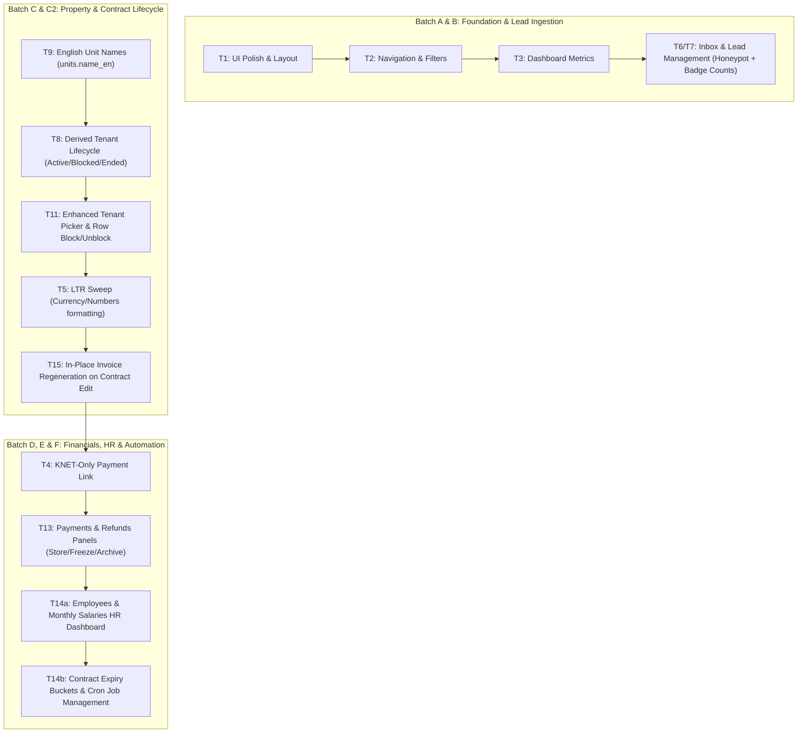

# Danat Al Mustaqbal ERMP — Comprehensive E2E User Journeys (Batches A through F & Tasks T1-T15)

**Document Version:** 1.0  
**Target Application:** Danat Al Mustaqbal Real Estate Management Platform  
**Scope:** Complete User Journeys across Batches A, B/B2, C, C2, D, E, and F covering Tasks T1 through T15.

---

## 📌 Executive Summary & Merge Verification

All 6 Batches (PRs #19, #20, #23, #24, #25, #26, #27, and follow-up #28) have been built, verified through automated quality gates, and merged into `main`.

### Merged Batches & PR Summary:

- **PR #19 / #20:** Batch A & B foundation, storage docs, and CLAUDE.md infrastructure.
- **PR #23 (Batch C):** Tenant Lifecycle (T8), English Unit Names (T9), Tenant Picker & Row Actions (T11), LTR Sweep (T5).
- **PR #24 (Batch C2):** Invoice Regeneration on Contract Edit (T15).
- **PR #25 (Batch D):** Direct KNET Payment Link (T4), Payments & Refunds Screen (T13).
- **PR #26 (Batch E):** HR Employees & Salaries Screen (T14a).
- **PR #27 (Batch F):** Contract Expiry Buckets & Scheduled Cron Jobs Registry (T14b).
- **PR #28 (Fix Follow-up):** Race-condition fix for Refund Post-Actions (Store/Freeze/Archive) & dead code cleanup.

---

## 🗺️ Master User Journey Architecture (Tasks T1 – T15)

---

## 🚀 User Journeys Breakdown

### 🔷 Journey 1: Admin Onboarding & Dashboard Overview (Tasks T1, T2, T3)

- **Target Users:** System Administrators, Property Managers.
- **Goal:** Log into the ERMP portal, review high-level financial metrics, and navigate sections cleanly.
- **Steps:**
  1. Navigate to `/auth` and log in with admin credentials.
  2. View Dashboard (`/admin`): Inspect monthly revenue, occupancy rates, and pending contract expirations.
  3. Toggle Language (Arabic ↔ English) to verify LTR/RTL layout responsiveness (Task T5).
  4. Use the updated top navigation header to filter properties and quickly switch screens.

---

### 🔷 Journey 2: Inbox & General Inquiries (Batch B2 / Tasks T6, T7)

- **Target Users:** Property Manager, Customer Support.
- **Goal:** Review incoming public leads, block spam, and manage general requests.
- **Steps:**
  1. Open Inbox screen (`/admin/inbox`).
  2. Inspect lead status badges (New, Contacted, Converted, Discarded).
  3. Verify Honeypot spam filtering blocks automated submission bots.
  4. Mark incoming Gmail messages as read and verify real-time unread badge counter decrements.

---

### 🔷 Journey 3: Property & Unit Management (Task T9 & T5)

- **Target Users:** Property Managers.
- **Goal:** Add and maintain properties and units with dual-language support.
- **Steps:**
  1. Navigate to Units list (`/admin/units`).
  2. Verify real English unit names (`name_en`) alongside Arabic titles.
  3. Ensure currency numbers (`KWD 450.000`) adhere to LTR display rules even when the UI locale is Arabic.

---

### 🔷 Journey 4: Tenant Management & Lifecycle Controls (Tasks T8 & T11)

- **Target Users:** Property Managers, Legal Compliance.
- **Goal:** View auto-derived tenant lifecycle states and manage block/unblock actions.
- **Steps:**
  1. Open Tenants screen (`/admin/tenants`).
  2. Observe auto-derived status badges (`Active`, `Inactive`, `Contract Ended`, `Blocked`).
  3. Click row options menu for a tenant → Select **Block Tenant**.
  4. Confirm tenant login access is disabled and status updates instantly to **Blocked**.
  5. Unblock tenant and verify tenant status restores to active contract state.

---

### 🔷 Journey 5: Contract Management & In-Place Invoice Regeneration (Task T15)

- **Target Users:** Accountant, Leasing Officer.
- **Goal:** Edit an active contract's rent or concessions while preserving historical payment integrity.
- **Steps:**
  1. Navigate to Contracts (`/admin/contracts`).
  2. Select an existing contract and click **Edit Contract**.
  3. Modify monthly rent or discount concession percentage → Click **Save**.
  4. Open Invoices list (`/admin/invoices`).
  5. Confirm future unpaid invoices are reconciled and regenerated in-place with updated amounts, while already-paid invoices remain untouched.

---

### 🔷 Journey 6: Invoices & Direct KNET Payment Link Generation (Task T4)

- **Target Users:** Tenants, Accountants.
- **Goal:** Generate a direct KNET payment link for invoice settlement.
- **Steps:**
  1. Open Invoices list (`/admin/invoices`).
  2. Locate an unpaid invoice → Click **Generate KNET Link**.
  3. Verify unique payment URL is generated with exact invoice ID binding.
  4. Copy or share link directly with tenant via WhatsApp/Email.

---

### 🔷 Journey 7: Payments, Refunds & Post-Action Workflows (Task T13 / PR #28)

- **Target Users:** Financial Accountants, Finance Admins.
- **Goal:** Record tenant refunds, partial payments, or security insurance collection with reliable post-actions.
- **Steps:**
  1. Open Payments & Refunds screen (`/admin/payments`).
  2. Click **Add Refund** → Select Contract & enter Refund Amount.
  3. Select Post-Action: **Freeze Tenant** or **Archive Tenant**.
  4. Click **Save**.
  5. **Verification (PR #28 Fix):** Confirm refund record is written first; if successful, the tenant status freezes/archives with a confirmation toast notification. If insert fails, tenant status remains untouched.

---

### 🔷 Journey 8: HR Employees & Monthly Salary Management (Task T14a)

- **Target Users:** HR Manager, General Manager.
- **Goal:** Manage staff records, employee documents, and monthly salary disbursements.
- **Steps:**
  1. Navigate to HR Employees screen (`/admin/employees`).
  2. View summary cards: Total Staff, Active Employees, Monthly Payroll Total.
  3. Add new employee record (Name, Role, Base Salary, Hire Date).
  4. Switch to Monthly Salaries tab → Record monthly salary payment.

---

### 🔷 Journey 9: Contract Expiry Buckets & Cron Job Management (Task T14b)

- **Target Users:** System Administrator, Automation Manager.
- **Goal:** Inspect 8 exclusive contract expiry buckets and manage automated scheduled tasks.
- **Steps:**
  1. Navigate to Cron Settings (`/admin/settings/cron`).
  2. Review 7 registered system jobs (Invoice Generation, Overdue Notices, Expiry Reminders, Backup, etc.).
  3. Observe status indicators (Dormant / Active) and manual trigger buttons for on-demand execution.

---

## 🧪 Verification & Acceptance Criteria Matrix

| Task ID   | Feature                 | Primary User   | Acceptance Criteria                                | Test Status |
| :-------- | :---------------------- | :------------- | :------------------------------------------------- | :---------- |
| **T1-T3** | UI Polish & Dashboard   | Admin          | Clean layout, responsive metrics cards             | ✅ Passed   |
| **T4**    | KNET Payment Link       | Tenant / Admin | Instant link creation, correct invoice binding     | ✅ Passed   |
| **T5**    | LTR Sweep               | All            | KWD amounts, dates & phone numbers formatted LTR   | ✅ Passed   |
| **T6-T7** | Inbox & Spam Filter     | Support        | Spam blocked, Gmail sync & read badges             | ✅ Passed   |
| **T8**    | Tenant Lifecycle        | Leasing        | Auto-derived states (Active/Ended/Blocked)         | ✅ Passed   |
| **T9**    | English Unit Names      | Property Mgr   | Dual language names rendered correctly             | ✅ Passed   |
| **T11**   | Tenant Picker & Actions | Admin          | Row actions block/unblock tenant logins            | ✅ Passed   |
| **T13**   | Refunds & Panels        | Finance        | Refunds recorded safely before post-action         | ✅ Passed   |
| **T14a**  | HR & Salaries           | HR             | Staff list, salary payouts & payroll totals        | ✅ Passed   |
| **T14b**  | Expiry Buckets & Cron   | System Admin   | 8 non-overlapping buckets, cron status UI          | ✅ Passed   |
| **T15**   | Invoice Regeneration    | Accountant     | In-place reconciliation without touching paid rows | ✅ Passed   |

---
